# Updated Rizal Provincial Library System Flowcharts

Edition: 17 November 2026

Current application source and existing regression coverage. These diagrams document implemented workflows; they do not certify every production integration.

The original sections 2.3.1-2.3.9 are retained; 2.3.7 is split into borrowing and returning. Additional workflows continue through 2.3.28.

These are documentation artifacts. No application behavior, database or account data is changed.

## 2.3.1 Login and Role Routing

Shows password or Face ID sign-in, account checks, first-login password replacement, and routing to the stored member or librarian role.

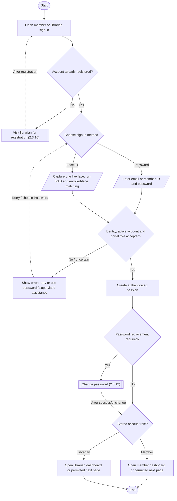

- Public catalog browsing requires no account. The current website registers members through librarians; it has no public registration form.
- Face ID is optional and requires existing enrollment. Failed or unavailable live-face verification does not grant access.
- Member and librarian are the two stored roles. A website login does not record entrance attendance.

Implementation references:

- [frontend/src/pages/public/LoginPage.jsx](../../frontend/src/pages/public/LoginPage.jsx)
- [frontend/src/App.jsx](../../frontend/src/App.jsx)
- [backend/routers/auth.py](../../backend/routers/auth.py)
- [backend/tests/test_first_login_password.py](../../backend/tests/test_first_login_password.py)
- [backend/tests/test_repair_attendance.py](../../backend/tests/test_repair_attendance.py)

## 2.3.2 Borrower Navigation

Shows navigation among the member dashboard, book discovery, My Reservations, and Profile.

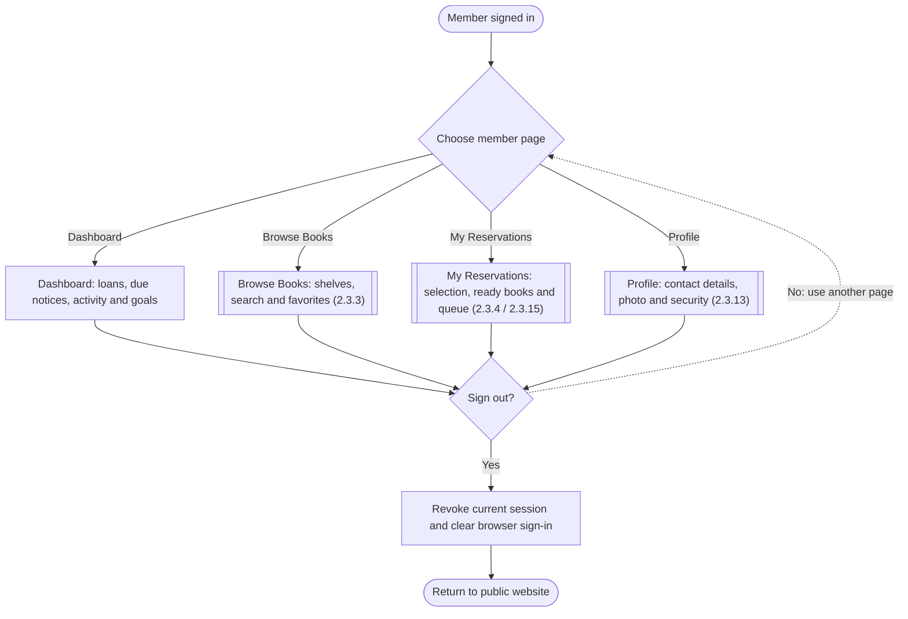

- The reserved-count button in Browse Books opens My Reservations.
- Borrowers can report a loan issue from the dashboard; only librarians complete physical borrow and return transactions.

Implementation references:

- [frontend/src/App.jsx](../../frontend/src/App.jsx)
- [frontend/src/components/UserLayout.jsx](../../frontend/src/components/UserLayout.jsx)
- [frontend/src/pages/user/UserHome.jsx](../../frontend/src/pages/user/UserHome.jsx)
- [frontend/src/pages/user/UserBrowseBooks.jsx](../../frontend/src/pages/user/UserBrowseBooks.jsx)

## 2.3.3 Browse Books and Add to Reservation Cart

Shows public and member discovery, book details, and selection for later reservation confirmation.

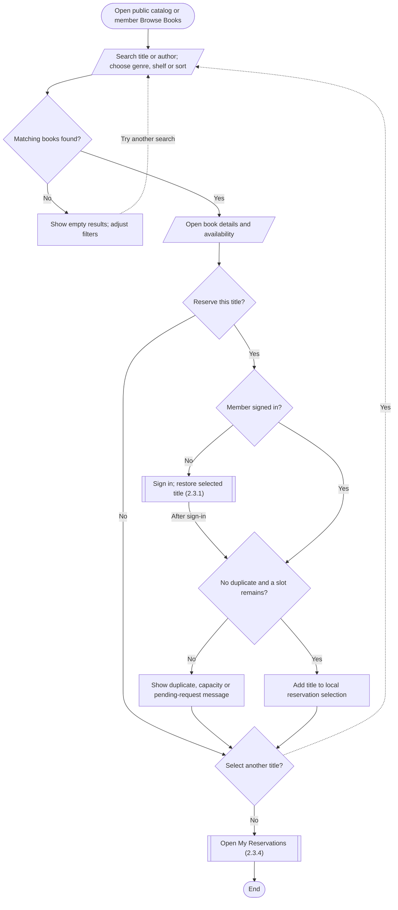

- Adding a selection does not hold stock, create a loan, or save a confirmed reservation.
- Landing-page searches open the public catalog and highlight matching title or author text. Member Featured shelves scroll sideways; the desktop public catalog uses a vertical grid.

Implementation references:

- [frontend/src/pages/public/PublicBrowse.jsx](../../frontend/src/pages/public/PublicBrowse.jsx)
- [frontend/src/pages/public/LandingPage.jsx](../../frontend/src/pages/public/LandingPage.jsx)
- [frontend/src/pages/user/UserBrowseBooks.jsx](../../frontend/src/pages/user/UserBrowseBooks.jsx)
- [frontend/src/api/reservationCart.js](../../frontend/src/api/reservationCart.js)

## 2.3.4 Reservation Checkout and Five-Book Limit

Shows authenticated batch confirmation, explicit queue agreement, the combined five-book allowance, and safe retry handling.

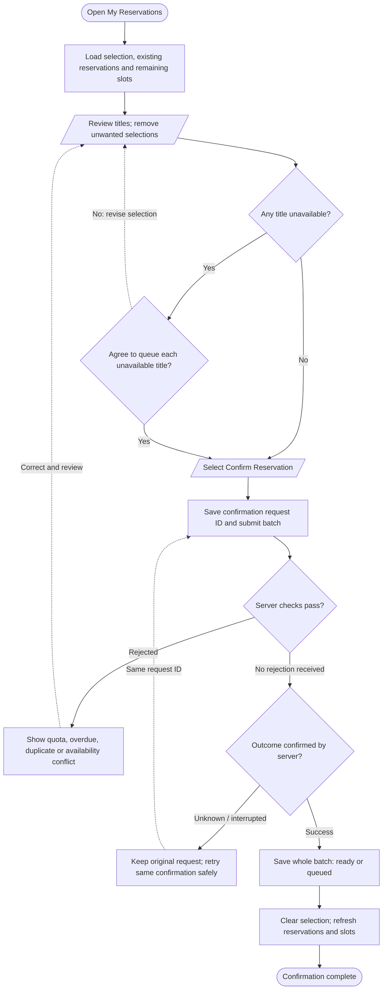

- The current confirmation endpoint does not request a face scan. At physical pickup, librarians identify the member by Face ID or supervised manual ID.
- Five-book limit = active/overdue loans + ready reservations + queued reservations + new selections. The server rechecks the limit and eligibility.
- Unavailable titles require explicit queue agreement. Ready reservations have a 24-hour pickup deadline; no exact physical copy is allocated by reservation.

Implementation references:

- [frontend/src/pages/user/UserReservations.jsx](../../frontend/src/pages/user/UserReservations.jsx)
- [backend/routers/reservations.py](../../backend/routers/reservations.py)
- [backend/services/reservation_confirmation.py](../../backend/services/reservation_confirmation.py)
- [backend/services/borrowing_capacity.py](../../backend/services/borrowing_capacity.py)
- [backend/tests/test_reservation_policy.py](../../backend/tests/test_reservation_policy.py)

## 2.3.5 Staff Logging and Entrance Attendance

Shows PIN-controlled attendance scanning, live-face validation, and time-in/time-out for a distinct encounter.

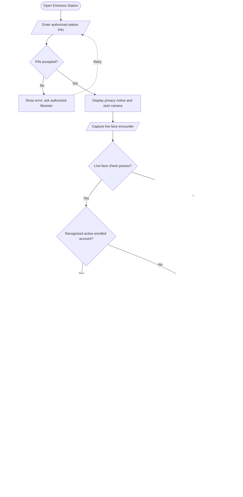

- This is entrance attendance for recognized enrolled accounts, not a separate payroll or staff scheduling module.
- The current station client debounces repeated frames and marks distinct encounters. Legacy clients retain the configured timing rules.
- Station PIN access does not issue account login cookies. Scanning pauses when the page is hidden, and failed connections are not saved for offline replay.

Implementation references:

- [frontend/src/pages/lib/EntryGate.jsx](../../frontend/src/pages/lib/EntryGate.jsx)
- [frontend/src/api/entryAttendance.js](../../frontend/src/api/entryAttendance.js)
- [backend/routers/kiosk.py](../../backend/routers/kiosk.py)
- [backend/services/entry_session_policy.py](../../backend/services/entry_session_policy.py)
- [backend/tests/test_entry_session_policy.py](../../backend/tests/test_entry_session_policy.py)

## 2.3.6 Add Book and QR Code Generation

Shows manual or ISBN-assisted book entry, optional descriptions, validation, physical-copy creation, and label preparation.

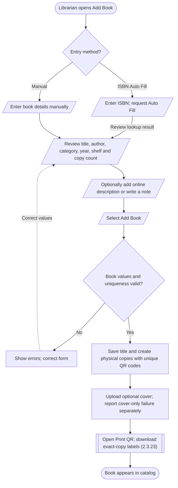

- A description is optional, public catalog text. Manual descriptions are supported when no online description is available.
- Each physical copy receives its own identity. QR image download/reprinting does not create more copies.
- If the book saves but its cover fails, retry only the cover upload. Resolve an unknown save outcome before submitting another book.

Implementation references:

- [frontend/src/pages/lib/LibAddBook.jsx](../../frontend/src/pages/lib/LibAddBook.jsx)
- [frontend/src/components/BookDescriptionField.jsx](../../frontend/src/components/BookDescriptionField.jsx)
- [backend/routers/inventory.py](../../backend/routers/inventory.py)
- [backend/services/book_copy_service.py](../../backend/services/book_copy_service.py)
- [backend/tests/test_book_description.py](../../backend/tests/test_book_description.py)

## 2.3.7a Borrow Transaction

Shows member identification, automatic selection from ready reservations, optional scanning for walk-ins, and reviewed lending.

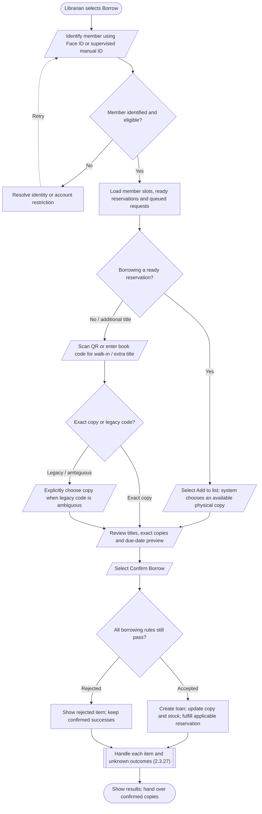

- Ready reservations use Add to list without mandatory QR scanning or code selection. Staff may change the copy before review and must hand over the copy shown. Queued requests are not ready loans.
- Selections and scans do not commit a loan. A ready reservation converts to a loan without consuming a second slot.
- Multi-book submissions are sequential independent requests. No silent copy substitution occurs if a selected copy becomes unavailable.
- Final server checks cover account status, overdue loans, the combined allowance, ready-hold capacity, duplicate title loans and exact-copy availability.

Implementation references:

- [frontend/src/components/CirculationDialog.jsx](../../frontend/src/components/CirculationDialog.jsx)
- [frontend/src/components/BorrowBookSelection.jsx](../../frontend/src/components/BorrowBookSelection.jsx)
- [frontend/src/components/CirculationMember.jsx](../../frontend/src/components/CirculationMember.jsx)
- [backend/routers/transactions.py](../../backend/routers/transactions.py)
- [backend/tests/test_circulation_atomicity.py](../../backend/tests/test_circulation_atomicity.py)

## 2.3.7b Return Transaction

Shows exact-copy lookup, explicit selection of ambiguous legacy loans, review, and updating the original loan.

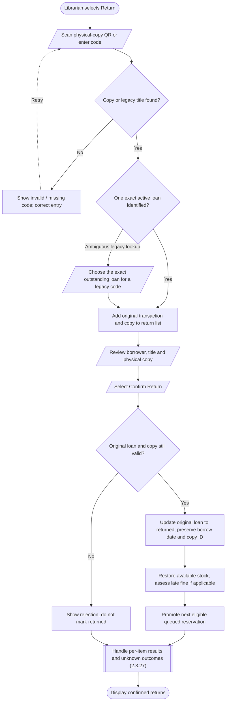

- A return closes the original loan; it does not create an unrelated return row or erase borrowing history.
- Return mode starts with book lookup and can contain different borrowers. Members do not self-confirm physical returns.
- An assessed fine is not payment collection. The current interface hides fine panels.

Implementation references:

- [frontend/src/components/CirculationDialog.jsx](../../frontend/src/components/CirculationDialog.jsx)
- [backend/routers/transactions.py](../../backend/routers/transactions.py)
- [backend/services/reservation_policy.py](../../backend/services/reservation_policy.py)
- [backend/tests/test_circulation_scanning.py](../../backend/tests/test_circulation_scanning.py)

## 2.3.8 Report Generation

Shows authorized reporting, Philippine-time filters, paged previews, and validated exports or print output.

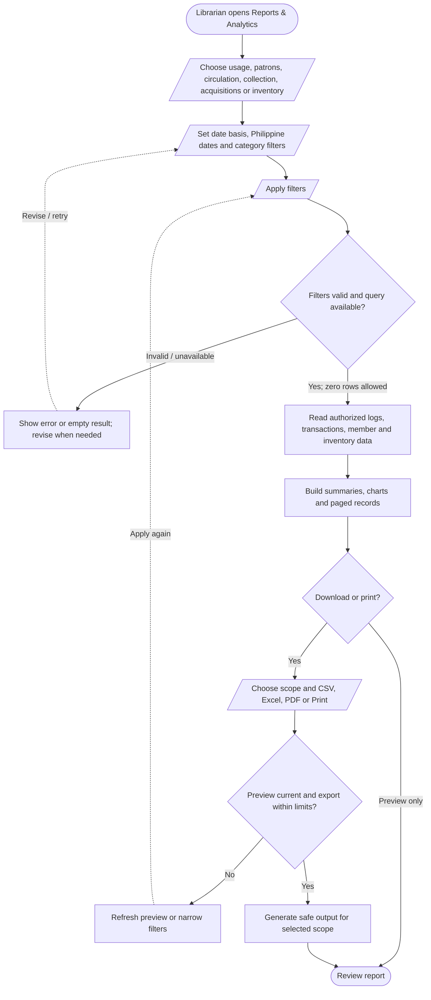

- Monthly PDF uses its own Month and Year controls. Report previews and exports preserve applied filters, not unsaved draft changes.
- Period circulation counts use borrow dates including returned loans. Current overdue and stock figures are snapshots. Export scope and row limits must be checked.
- Reports are librarian-only. Acquisition reporting needs its separate schema upgrade; these diagrams do not establish that every production prerequisite is complete.

Implementation references:

- [frontend/src/pages/lib/LibReports.jsx](../../frontend/src/pages/lib/LibReports.jsx)
- [backend/routers/reporting.py](../../backend/routers/reporting.py)
- [backend/routers/reports.py](../../backend/routers/reports.py)
- [backend/services/reporting.py](../../backend/services/reporting.py)
- [backend/tests/test_reporting_center.py](../../backend/tests/test_reporting_center.py)

## 2.3.9 Due Books Monitoring

Shows refresh-time overdue evaluation, due-date filtering, librarian review, and the link to physical return processing.

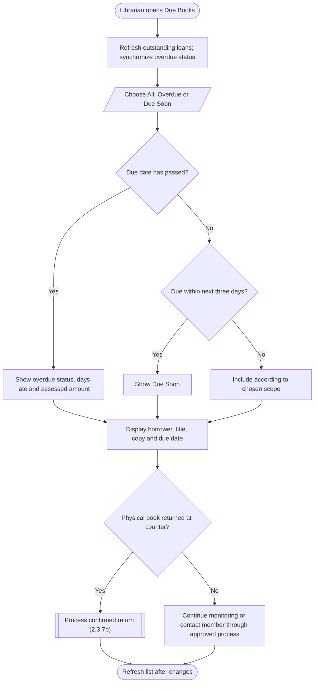

- Due Soon is the next three days. The default All due-book query includes overdue loans and loans due within seven days; broader loan records are separate.
- Overdue loans can prevent new borrowing. Email/SMS overdue reminders are currently unavailable, so this chart does not claim automatic message delivery.

Implementation references:

- [frontend/src/pages/lib/LibDueBooks.jsx](../../frontend/src/pages/lib/LibDueBooks.jsx)
- [backend/routers/librarian.py](../../backend/routers/librarian.py)
- [backend/services/loan_policy.py](../../backend/services/loan_policy.py)
- [backend/tests/test_overdue_policy.py](../../backend/tests/test_overdue_policy.py)

## 2.3.10 Member Registration and Temporary Password Delivery

Shows librarian registration with optional identification uploads, email-first credential delivery, and supervised fallback.

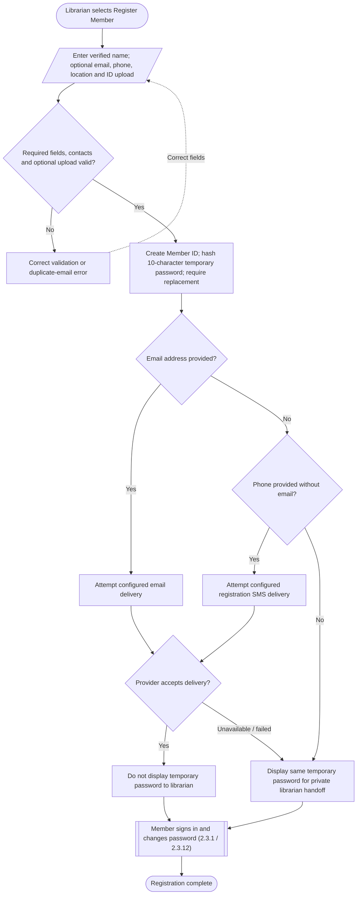

- Government ID upload is optional. If supplied, private upload validation still applies.
- SMS is selected only when no email is supplied. Failed email delivery does not automatically switch to the phone. Missing or failed delivery falls back to private librarian handoff.
- Provider acceptance is not proof that a message reached the inbox or handset. Entered contacts remain unverified until the separate email verification procedure.

Implementation references:

- [frontend/src/pages/lib/LibUsers.jsx](../../frontend/src/pages/lib/LibUsers.jsx)
- [backend/routers/librarian.py](../../backend/routers/librarian.py)
- [backend/services/registration_delivery.py](../../backend/services/registration_delivery.py)
- [backend/tests/test_auth_registration_uploads.py](../../backend/tests/test_auth_registration_uploads.py)

## 2.3.11 Forgotten Password and Librarian-Assisted Recovery

Shows recovery through a previously verified email or supervised librarian reset when email recovery is unavailable.

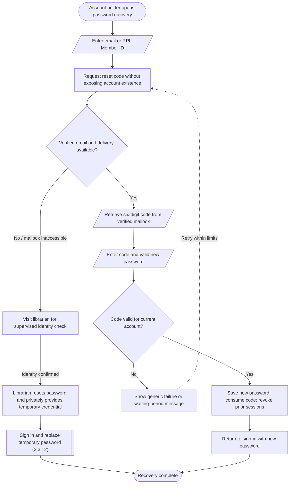

- Self-service recovery uses a previously verified email. A phone number or registration SMS does not enable SMS password recovery.
- Public responses and errors avoid confirming which accounts exist. Code expiry, resend limits and attempt limits remain enforced.
- Librarian reset credentials can have a different length from the 10-character initial-registration password.

Implementation references:

- [frontend/src/pages/public/ForgotPasswordPage.jsx](../../frontend/src/pages/public/ForgotPasswordPage.jsx)
- [backend/routers/auth.py](../../backend/routers/auth.py)
- [backend/services/password_reset.py](../../backend/services/password_reset.py)
- [backend/routers/librarian.py](../../backend/routers/librarian.py)
- [backend/tests/test_password_recovery.py](../../backend/tests/test_password_recovery.py)

## 2.3.12 First-Login and Voluntary Password Change

Shows mandatory replacement of temporary passwords and authenticated password changes.

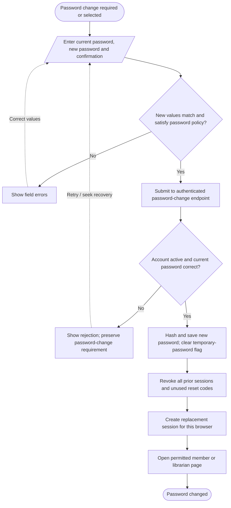

- New passwords require 8-128 characters including at least one digit.
- Until a required replacement succeeds, ordinary protected actions are blocked. Session/profile retrieval, password change and logout remain available.

Implementation references:

- [frontend/src/pages/ChangePasswordPage.jsx](../../frontend/src/pages/ChangePasswordPage.jsx)
- [frontend/src/pages/user/UserProfile.jsx](../../frontend/src/pages/user/UserProfile.jsx)
- [backend/routers/users.py](../../backend/routers/users.py)
- [backend/dependencies.py](../../backend/dependencies.py)
- [backend/tests/test_first_login_password.py](../../backend/tests/test_first_login_password.py)

## 2.3.13 Profile Details and Optional Profile Photo

Shows permitted member contact edits, a locked verified name, and adding, changing or removing an avatar.

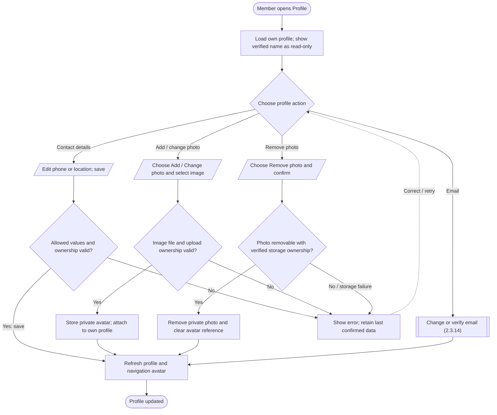

- Members cannot change their verified name in the form or by sending a different name to the server. Name corrections require library assistance.
- A profile photo is optional and separate from face-recognition enrollment. Removing an avatar does not delete the Face ID template.
- Only confirmed changes refresh the interface. Invalid or unavailable storage operations do not report a successful removal.

Implementation references:

- [frontend/src/pages/user/UserProfile.jsx](../../frontend/src/pages/user/UserProfile.jsx)
- [backend/routers/users.py](../../backend/routers/users.py)
- [backend/services/member_deletion.py](../../backend/services/member_deletion.py)
- [frontend/src/api/profileUpdates.js](../../frontend/src/api/profileUpdates.js)

## 2.3.14 Email Change and Contact Verification

Shows password-confirmed email changes and separate verification before the address can be used for recovery.

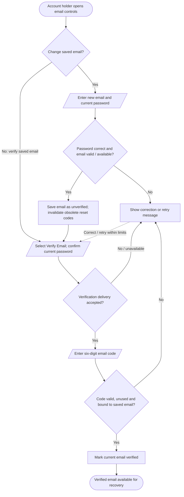

- Typing an email during registration or profile editing does not verify ownership.
- A changed email remains unverified until the purpose/contact-bound code succeeds. Never publish verification codes in documentation or screenshots.

Implementation references:

- [frontend/src/components/EmailContact.jsx](../../frontend/src/components/EmailContact.jsx)
- [backend/routers/auth.py](../../backend/routers/auth.py)
- [backend/routers/users.py](../../backend/routers/users.py)
- [backend/services/password_reset.py](../../backend/services/password_reset.py)

## 2.3.15 Reservation Queue, Pickup, Cancellation and Expiry

Shows the lifecycle of ready and queued reservations, including FIFO promotion and cancellation.

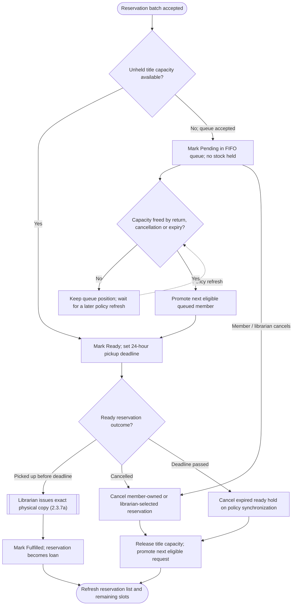

- Only ready reservations hold title-level capacity. Pending requests do not allocate stock, and no reservation guarantees a particular physical copy.
- Expiry/promotion runs when relevant requests or stock-changing operations synchronize policy; there is no claim of a continuously running expiry scheduler.
- Both ready and queued reservations count toward the combined five-book allowance. Refreshing a page does not extend a pickup deadline.

Implementation references:

- [backend/services/reservation_policy.py](../../backend/services/reservation_policy.py)
- [backend/services/reservation_confirmation.py](../../backend/services/reservation_confirmation.py)
- [backend/routers/reservations.py](../../backend/routers/reservations.py)
- [frontend/src/pages/lib/LibReservations.jsx](../../frontend/src/pages/lib/LibReservations.jsx)
- [backend/tests/test_reservation_policy.py](../../backend/tests/test_reservation_policy.py)

## 2.3.16 Inventory Editing, Stock Adjustment and Title Deletion

Shows updating book metadata or covers, safe stock changes, and history-protected title deletion.

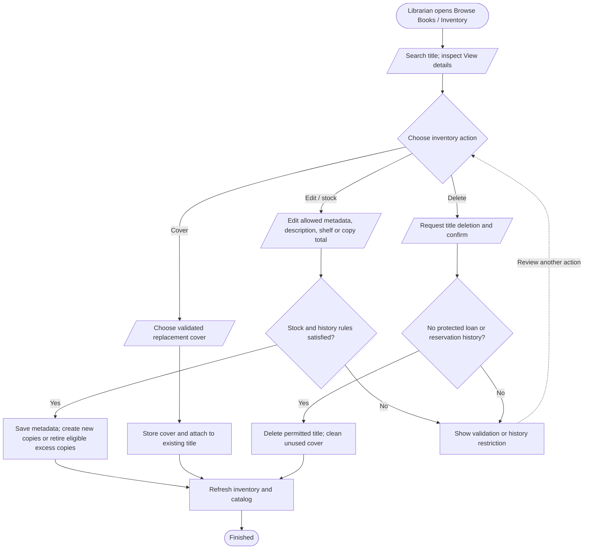

- Reducing stock retires eligible physical copies; it does not delete or recycle their QR identities. Borrowed copies and ready-reservation capacity remain protected.
- View details is read-only. Books with historical loan or reservation dependencies cannot be casually deleted.
- Category review has its own workflow (2.3.28). Acquisition metadata is maintained through Reports, not an Acquisitions button in the inventory row.

Implementation references:

- [frontend/src/pages/lib/LibInventory.jsx](../../frontend/src/pages/lib/LibInventory.jsx)
- [frontend/src/components/BookEditDialog.jsx](../../frontend/src/components/BookEditDialog.jsx)
- [backend/routers/inventory.py](../../backend/routers/inventory.py)
- [backend/services/book_copy_service.py](../../backend/services/book_copy_service.py)
- [backend/tests/test_book_edit.py](../../backend/tests/test_book_edit.py)

## 2.3.17 ISBN Lookup and Workbook Book Import

Shows multiple ISBN-assisted additions and complete-record XLSX import with separate results for valid, duplicate and rejected rows.

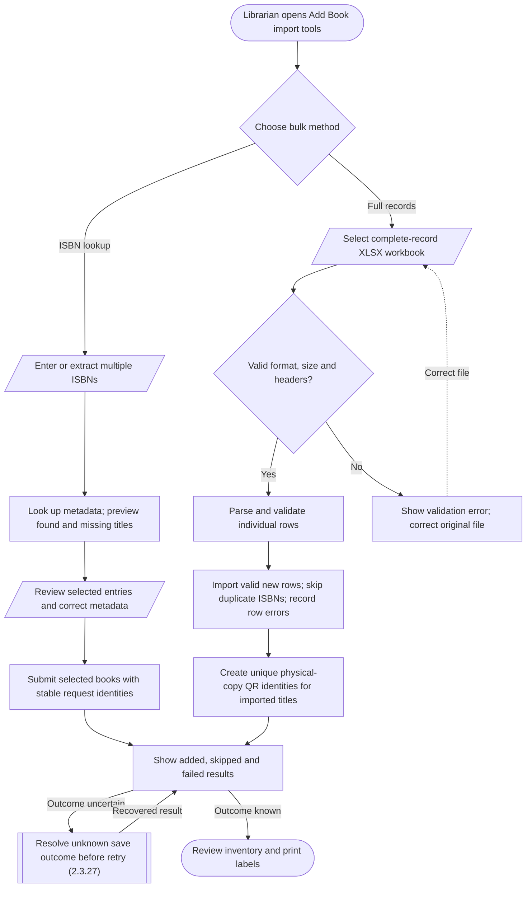

- Full inventory import uses XLSX; legacy XLS must be converted. The current server limit is 10 MB. ISBN-only extraction/lookup is a different workflow.
- A workbook can report partial row errors. Preserve successful results; do not assume that one bad row rolls back every imported book.
- Retryable workbook requests are bound to the original file fingerprint and request ID. Acquisition-metadata CSV/XLSX import is separate (2.3.25).

Implementation references:

- [frontend/src/pages/lib/LibAddBook.jsx](../../frontend/src/pages/lib/LibAddBook.jsx)
- [backend/routers/inventory.py](../../backend/routers/inventory.py)
- [backend/services/excel_service.py](../../backend/services/excel_service.py)
- [frontend/src/api/inventoryWrites.js](../../frontend/src/api/inventoryWrites.js)

## 2.3.18 Member Status, Password Reset and Account Removal

Shows supervised account administration with separate status, reset and deletion actions.

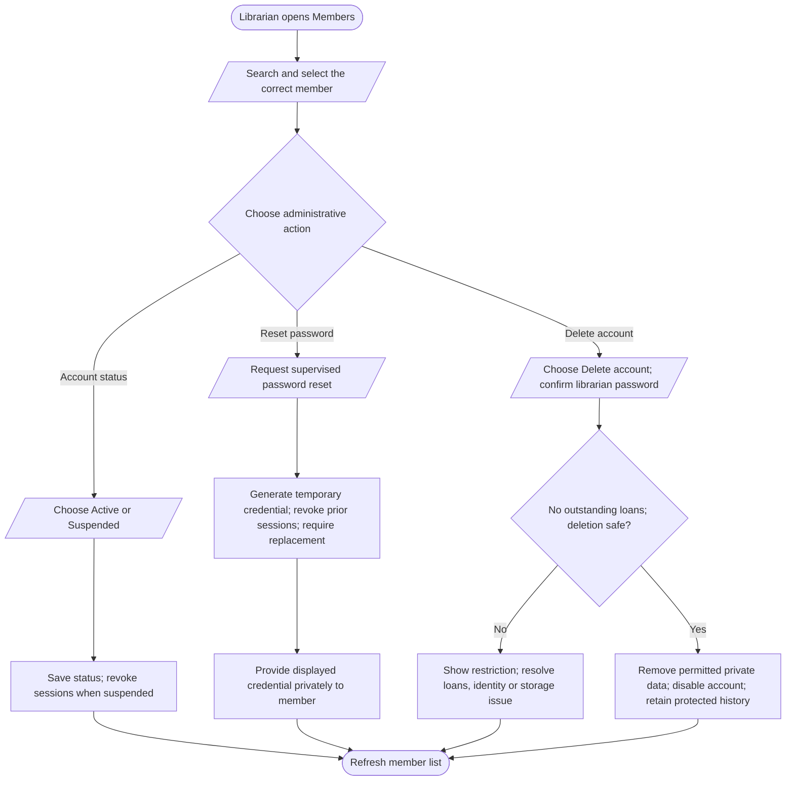

- A librarian password is required for destructive member/face deletion. Account deletion is blocked while books remain outstanding.
- Member account removal follows the implemented soft-deletion and private-file ownership checks; it is not arbitrary deletion of lending history.
- Resetting a member password is distinct from registration email/SMS delivery. Use the credential actually returned for the reset operation.

Implementation references:

- [frontend/src/pages/lib/LibUsers.jsx](../../frontend/src/pages/lib/LibUsers.jsx)
- [backend/routers/librarian.py](../../backend/routers/librarian.py)
- [backend/services/member_deletion.py](../../backend/services/member_deletion.py)

## 2.3.19 Librarian-Assisted Face Enrollment and Face Removal

Shows supervised enrollment or replacement with live-face and duplicate-account checks, plus explicit face-data removal.

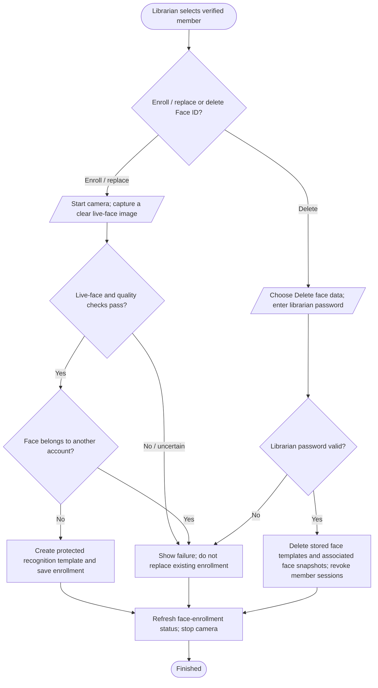

- Enrollment is librarian-assisted and distinct from a profile photo. A failed PAD/quality check must not become a successful enrollment.
- Duplicate-face checks prevent enrollment to another account. Existing recognition compatibility and encrypted biometric storage remain in place.
- Face-data removal does not delete loan history or the entire member account. It is a separate explicit operation.

Implementation references:

- [frontend/src/pages/lib/LibUsers.jsx](../../frontend/src/pages/lib/LibUsers.jsx)
- [backend/routers/librarian.py](../../backend/routers/librarian.py)
- [backend/services/face_engine_service.py](../../backend/services/face_engine_service.py)
- [backend/services/member_deletion.py](../../backend/services/member_deletion.py)
- [backend/tests/test_face_engine_upgrade.py](../../backend/tests/test_face_engine_upgrade.py)

## 2.3.20 Recommendations, Trending and Favorites

Shows history-dependent Featured shelves, favorites, and genre sorting without inventing a star-rating feature.

```mermaid
flowchart TD
  n_s(["Member opens Browse Books"])
  n_history{"Previous borrowing history exists?"}
  n_recommend["Load recommendations from member activity and similar items"]
  n_fallback["Use content / popularity fallback where needed"]
  n_trending["Show Trending shelf"]
  n_new["Show What's new and Books we love shelves"]
  n_choose{"Choose discovery action"}
  n_favorite[/"Toggle heart for a title"/]
  n_save["Save or remove own favorite after server confirmation"]
  n_genre[/"Choose genre / All Books; select Trending, Newest, Most loved or Title"/]
  n_results["Show sorted, paged matching books"]
  n_view[["View details or add to selection (2.3.3)"]]
  n_e(["Continue browsing"])
  n_s --> n_history
  n_history -->|"Yes"| n_recommend
  n_recommend --> n_fallback
  n_fallback --> n_trending
  n_history -->|"New member"| n_trending
  n_trending --> n_new
  n_new --> n_choose
  n_choose -->|"Favorite"| n_favorite
  n_favorite --> n_save
  n_save --> n_e
  n_choose -->|"Genre / sort"| n_genre
  n_genre --> n_results
  n_results --> n_view
  n_choose -->|"Open title"| n_view
  n_view --> n_e
```

- Members with borrowing history see Recommended for you above Trending. New members begin with Trending. Featured collections scroll sideways.
- Books we love and Most loved use recorded favorites; there is no star-rating or separate editorial-review feature.
- Recommendations are calculated on demand with collaborative, content and popularity fallbacks. The system does not claim a separately trained model or measured reader accuracy.

Implementation references:

- [frontend/src/pages/user/UserBrowseBooks.jsx](../../frontend/src/pages/user/UserBrowseBooks.jsx)
- [backend/routers/recommendations.py](../../backend/routers/recommendations.py)
- [backend/routers/books.py](../../backend/routers/books.py)
- [frontend/src/api/useBookRecommendations.js](../../frontend/src/api/useBookRecommendations.js)

## 2.3.21 Reading Activity, Goals and Personal Transcript

Shows viewing recorded reading/visit information, saving goals, and downloading the account-owned transcript.

```mermaid
flowchart TD
  n_s(["Member opens Dashboard"])
  n_load["Load own loans, reading statistics, activity and goals"]
  n_action{"Choose activity task"}
  n_view["Review recorded borrowing, genres and library visits"]
  n_goals[/"Select Set Goals; enter books, genres and visit targets"/]
  n_valid{"Goal values valid?"}
  n_error["Show validation error"]
  n_save["Save goals for current member"]
  n_transcript[/"Request own transcript through supported API service"/]
  n_authorized{"Authenticated owner and report request valid?"}
  n_pdf["Generate own reading transcript PDF"]
  n_failure["Show error; keep current records"]
  n_e(["Review confirmed result"])
  n_s --> n_load
  n_load --> n_action
  n_action -->|"View activity"| n_view
  n_view --> n_e
  n_action -->|"Set Goals"| n_goals
  n_goals --> n_valid
  n_valid -->|"No"| n_error
  n_error -.->|"Correct values"| n_goals
  n_valid -->|"Yes"| n_save
  n_save --> n_e
  n_action -->|"Transcript service"| n_transcript
  n_transcript --> n_authorized
  n_authorized -->|"Yes"| n_pdf
  n_authorized -->|"No"| n_failure
  n_pdf --> n_e
  n_failure --> n_e
```

- Visits are attendance sessions, not proof that a particular book was read. Charts summarize recorded activity.
- Transcripts are owner-scoped. Members cannot download another member profile or transcript by changing an identifier.
- The owner-scoped transcript API exists, but the current member pages do not show a transcript download button. That branch describes the supported service.

Implementation references:

- [frontend/src/pages/user/UserHome.jsx](../../frontend/src/pages/user/UserHome.jsx)
- [frontend/src/pages/user/UserProfile.jsx](../../frontend/src/pages/user/UserProfile.jsx)
- [backend/routers/recommendations.py](../../backend/routers/recommendations.py)
- [backend/routers/reports.py](../../backend/routers/reports.py)

## 2.3.22 Loan Issue Reports and In-App Notifications

Shows member reporting of a current loan problem and librarian review of the resulting in-app notification.

```mermaid
flowchart TD
  n_s(["Member reviews an outstanding loan"])
  n_report[/"Select Report Issue"/]
  n_reason[/"Choose damaged, wrong book, lost or other; add optional note"/]
  n_submit["Submit against original loan transaction"]
  n_owner{"Loan is outstanding and owned by current member?"}
  n_reject["Show rejection; do not create report"]
  n_notice["Create librarian in-app loan-issue notification"]
  n_staff[/"Librarian opens notifications and reviews issue"/]
  n_follow["Use approved supervised resolution process"]
  n_read[/"Mark notification read or mark all own notices read"/]
  n_e(["Issue communicated; loan state unchanged"])
  n_s --> n_report
  n_report --> n_reason
  n_reason --> n_submit
  n_submit --> n_owner
  n_owner -->|"No"| n_reject
  n_reject --> n_e
  n_owner -->|"Yes"| n_notice
  n_notice --> n_staff
  n_staff --> n_follow
  n_follow --> n_read
  n_read --> n_e
```

- Submitting an issue is not a return, copy replacement, fine settlement or payment. Book-condition photo capture is not implemented.
- Members also receive their own in-app notices, such as reservation status updates, and can mark them read. Read status is account-scoped.
- No email/SMS delivery is implied by an in-app notice.

Implementation references:

- [frontend/src/pages/user/UserHome.jsx](../../frontend/src/pages/user/UserHome.jsx)
- [backend/routers/transactions.py](../../backend/routers/transactions.py)
- [backend/routers/users.py](../../backend/routers/users.py)
- [backend/routers/librarian.py](../../backend/routers/librarian.py)

## 2.3.23 Physical-Copy QR Label Download and Bulk Export

Shows individual PNG labels, selected-copy PDFs, and complete matching-copy exports with bounded batches.

```mermaid
flowchart TD
  n_s(["Librarian opens Print QR"])
  n_search[/"Search title, author or physical-copy QR"/]
  n_mode{"Choose label scope"}
  n_single[/"Choose exact copy; download PNG"/]
  n_selected[/"Select copies; Select Visible affects current page only"/]
  n_limit{"1-1,000 copies selected?"}
  n_pdf["Generate selected-copy PDF"]
  n_all[/"Select Export all matching"/]
  n_snapshot["Capture matching physical-copy IDs"]
  n_batches["Fetch bounded label batches and count manifest"]
  n_complete{"Every requested label generated?"}
  n_zip["Build ZIP after all batches succeed"]
  n_error["Show error; preserve selection and offer retry"]
  n_print[/"Print and attach each exact-copy label"/]
  n_e(["Labels prepared"])
  n_s --> n_search
  n_search --> n_mode
  n_mode -->|"One copy"| n_single
  n_single --> n_print
  n_mode -->|"Selected copies"| n_selected
  n_selected --> n_limit
  n_limit -->|"Yes"| n_pdf
  n_limit -->|"No: use matching export"| n_error
  n_pdf --> n_print
  n_mode -->|"All matching"| n_all
  n_all --> n_snapshot
  n_snapshot --> n_batches
  n_batches --> n_complete
  n_complete -->|"Yes"| n_zip
  n_complete -->|"No"| n_error
  n_zip --> n_print
  n_error -.->|"Correct / retry"| n_mode
  n_print --> n_e
```

- A printed code identifies one physical copy. Reprinting does not add stock, change copy identity, or record a loan.
- Complete matching export uses label batches of 200 and fails visibly if any expected identity or batch is missing. Do not treat an interrupted download as complete.

Implementation references:

- [frontend/src/pages/lib/LibQRBulk.jsx](../../frontend/src/pages/lib/LibQRBulk.jsx)
- [frontend/src/api/librarian.js](../../frontend/src/api/librarian.js)
- [backend/routers/inventory.py](../../backend/routers/inventory.py)
- [backend/services/book_copy_service.py](../../backend/services/book_copy_service.py)

## 2.3.24 Appearance Settings and Entrance Station PIN Replacement

Shows browser appearance preferences and password-confirmed replacement of the staff station PIN.

```mermaid
flowchart TD
  n_s(["Open applicable appearance controls or librarian Settings"])
  n_choice{"Choose setting"}
  n_appearance[/"Choose Light or Dark appearance"/]
  n_local["Save current-browser theme preference"]
  n_pin[/"Librarian checks station PIN configured status"/]
  n_input[/"Enter current librarian password and repeat a new 6-12 digit PIN"/]
  n_valid{"Password correct and PIN values valid / matching?"}
  n_error["Show correction message"]
  n_save["Store only protected PIN hash; activate new station PIN"]
  n_stations["Older stations fail next PIN check; unlock with new PIN"]
  n_e(["Settings confirmed"])
  n_s --> n_choice
  n_choice -->|"Appearance"| n_appearance
  n_appearance --> n_local
  n_local --> n_e
  n_choice -->|"Station PIN"| n_pin
  n_pin --> n_input
  n_input --> n_valid
  n_valid -->|"No"| n_error
  n_error -.->|"Correct values"| n_input
  n_valid -->|"Yes"| n_save
  n_save --> n_stations
  n_stations --> n_e
```

- Only librarians manage the station PIN. The existing PIN is never displayed; replacement requires the librarian password, not the old PIN.
- A configured database PIN takes precedence over the server fallback and is checked on each station request. Station PINs and account passwords serve different purposes.

Implementation references:

- [frontend/src/pages/lib/LibSettings.jsx](../../frontend/src/pages/lib/LibSettings.jsx)
- [frontend/src/components/UserLayout.jsx](../../frontend/src/components/UserLayout.jsx)
- [backend/routers/librarian_settings.py](../../backend/routers/librarian_settings.py)
- [backend/services/entry_station_pin.py](../../backend/services/entry_station_pin.py)
- [backend/tests/test_entry_station_pin.py](../../backend/tests/test_entry_station_pin.py)

## 2.3.25 Acquisition Metadata Entry and Import

Shows recording verified acquisition details on existing physical copies through the reporting workspace.

```mermaid
flowchart TD
  n_s(["Librarian opens Reports: Acquisitions"])
  n_method{"Single copy or metadata import?"}
  n_copy[/"Enter numeric physical-copy ID; look up and verify title"/]
  n_edit[/"Enter verified source, date, donor / supplier, cost and reference"/]
  n_file[/"Prepare CSV / XLSX metadata file; upload for preview"/]
  n_preview{"File and all referenced copy IDs valid?"}
  n_review[/"Review replacements; confirm Apply acquisition records"/]
  n_version{"Copy data and version still valid?"}
  n_error["Show errors or changed record; reload / preview again"]
  n_save["Save acquisition metadata for existing copies"]
  n_refresh["Refresh acquisition report and preview"]
  n_e(["Metadata recorded; stock unchanged"])
  n_s --> n_method
  n_method -->|"Single"| n_copy
  n_copy --> n_edit
  n_edit --> n_version
  n_method -->|"Import"| n_file
  n_file --> n_preview
  n_preview -->|"No"| n_error
  n_preview -->|"Yes"| n_review
  n_review --> n_version
  n_version -->|"No"| n_error
  n_error -.->|"Correct / reload"| n_method
  n_version -->|"Yes"| n_save
  n_save --> n_refresh
  n_refresh --> n_e
```

- This reporting workflow requires the separate reporting schema. It is not the removed Acquisition details section of Add Book.
- Acquisition imports are limited to 500 rows and 1 MB. Blank imported cells clear existing acquisition fields; preview does not save anything.
- Metadata refers to existing physical-copy IDs, not a printed QR string. It does not create stock or reassign physical-copy codes.

Implementation references:

- [frontend/src/components/reporting/AcquisitionEditor.jsx](../../frontend/src/components/reporting/AcquisitionEditor.jsx)
- [backend/routers/reporting.py](../../backend/routers/reporting.py)
- [backend/schemas/reporting.py](../../backend/schemas/reporting.py)
- [backend/tests/test_reporting_center.py](../../backend/tests/test_reporting_center.py)

## 2.3.26 Librarian Workspace, Dashboard and Navigation

Shows the initially hidden sidebar, dashboard summaries and access to each librarian workspace.

```mermaid
flowchart TD
  n_s(["Librarian authentication complete"])
  n_home["Open Dashboard; load authorized summaries and charts"]
  n_menu[/"Open menu icon to reveal hidden sidebar"/]
  n_choose{"Choose work area"}
  n_collection[["Browse Books / Add Book / Print QR (2.3.6, 2.3.16, 2.3.23)"]]
  n_circulation[["Borrow / Return / Reservations / Due Books (2.3.7, 2.3.9, 2.3.15)"]]
  n_people[["Members and face enrollment (2.3.10, 2.3.18, 2.3.19)"]]
  n_reports[["Reports and acquisition metadata (2.3.8, 2.3.25)"]]
  n_settings[["Settings and station PIN (2.3.24)"]]
  n_next{"Continue working?"}
  n_logout["Sign out; revoke current browser session"]
  n_e(["Return to public staff portal"])
  n_s --> n_home
  n_home --> n_menu
  n_menu --> n_choose
  n_choose -->|"Collection"| n_collection
  n_choose -->|"Circulation"| n_circulation
  n_choose -->|"Members"| n_people
  n_choose -->|"Reports"| n_reports
  n_choose -->|"Settings"| n_settings
  n_collection --> n_next
  n_circulation --> n_next
  n_people --> n_next
  n_reports --> n_next
  n_settings --> n_next
  n_next -.->|"Yes"| n_menu
  n_next -->|"No"| n_logout
  n_logout --> n_e
```

- The sidebar starts hidden on desktop and mobile. Selecting navigation opens the chosen workspace without changing its authorization requirements.
- Dashboard notifications and shortcuts link to the relevant workflows. A summary card is not itself a circulation submission.

Implementation references:

- [frontend/src/components/LibLayout.jsx](../../frontend/src/components/LibLayout.jsx)
- [frontend/src/pages/lib/LibDashboard.jsx](../../frontend/src/pages/lib/LibDashboard.jsx)
- [frontend/src/App.jsx](../../frontend/src/App.jsx)
- [backend/routers/auth.py](../../backend/routers/auth.py)

## 2.3.27 Safe Submission, Partial Results and Unknown Outcome Recovery

Shows how reservation, inventory and circulation writes preserve request identity and avoid accidental duplicate actions.

```mermaid
flowchart TD
  n_s(["Review a write operation"])
  n_prepare["Save original payload and account-scoped request ID"]
  n_send[/"Submit online; do not treat scan or local selection as success"/]
  n_known{"Definite server result received?"}
  n_unknown["Stop further dependent submissions; preserve pending request"]
  n_recover[/"Recover saved request using original ID"/]
  n_kind{"Request type?"}
  n_receipt["Inventory / circulation: look up saved receipt; explicitly retry same key if needed"]
  n_batch["Reservation: retry exact saved confirmation batch"]
  n_resolved{"Outcome now confirmed?"}
  n_keep["Keep unknown state; request assistance without inventing success"]
  n_success{"Operation accepted?"}
  n_failed["Show definitive rejection and unattempted items"]
  n_commit["Show committed result; preserve earlier confirmed successes"]
  n_more{"More independent circulation items?"}
  n_e(["Review final results"])
  n_s --> n_prepare
  n_prepare --> n_send
  n_send --> n_known
  n_known -->|"No / interrupted"| n_unknown
  n_unknown --> n_recover
  n_recover --> n_kind
  n_kind -->|"Inventory / circulation"| n_receipt
  n_kind -->|"Reservation"| n_batch
  n_receipt --> n_resolved
  n_batch --> n_resolved
  n_resolved -->|"No"| n_keep
  n_keep --> n_e
  n_resolved -->|"Yes"| n_success
  n_known -->|"Yes"| n_success
  n_success -->|"Rejected"| n_failed
  n_failed --> n_e
  n_success -->|"Accepted"| n_commit
  n_commit --> n_more
  n_more -.->|"Yes; next item"| n_prepare
  n_more -->|"No"| n_e
```

- Do not clear pending recovery information, invent a new key, or infer success from a similar-looking loan. An unknown result is not a confirmed failure.
- Circulation lists send independent sequential requests; earlier successes remain valid. Reservation confirmation is an atomic batch.
- There is no durable offline queue or automatic write replay. Recovery and retry require a server connection and the original operation identity.

Implementation references:

- [frontend/src/api/circulationRecovery.js](../../frontend/src/api/circulationRecovery.js)
- [frontend/src/api/inventoryWrites.js](../../frontend/src/api/inventoryWrites.js)
- [frontend/src/pages/user/UserReservations.jsx](../../frontend/src/pages/user/UserReservations.jsx)
- [backend/services/inventory_writes.py](../../backend/services/inventory_writes.py)
- [backend/tests/test_circulation_atomicity.py](../../backend/tests/test_circulation_atomicity.py)

## 2.3.28 Category Normalization and Librarian Review

Shows automatic server category mapping and the Add Book review panel for unresolved imported labels.

```mermaid
flowchart TD
  n_s(["New or imported category label received"])
  n_map["Check saved override or supported category mapping"]
  n_known{"Supported category resolved?"}
  n_normal["Save normalized category and visible catalog state"]
  n_hidden["Preserve original label; mark unresolved book hidden"]
  n_review[/"Librarian opens Add Book: Category review panel"/]
  n_choice[/"Select supported master category; submit resolution"/]
  n_valid{"Librarian and master category valid?"}
  n_error["Show error; preserve unresolved state"]
  n_save["Apply category override to hidden books with exact original label"]
  n_refresh["Make resolved books available to category lists and catalog"]
  n_e(["Category state saved"])
  n_s --> n_map
  n_map --> n_known
  n_known -->|"Yes"| n_normal
  n_normal --> n_e
  n_known -->|"No"| n_hidden
  n_hidden --> n_review
  n_review --> n_choice
  n_choice --> n_valid
  n_valid -->|"No"| n_error
  n_error -.->|"Correct resolution"| n_choice
  n_valid -->|"Yes"| n_save
  n_save --> n_refresh
  n_refresh --> n_e
```

- Raw labels are reconciled to the supported genre vocabulary. Unresolved books retain the original label and remain hidden until an authorized resolution.
- The Category review panel appears on Add Book. Choosing a master category resolves hidden books with the same exact original label; a suggestion alone does not save a resolution.

Implementation references:

- [frontend/src/components/CategoryReview.jsx](../../frontend/src/components/CategoryReview.jsx)
- [frontend/src/pages/lib/LibAddBook.jsx](../../frontend/src/pages/lib/LibAddBook.jsx)
- [backend/routers/inventory.py](../../backend/routers/inventory.py)
- [backend/services/category_service.py](../../backend/services/category_service.py)
