# Simple black-and-white system flowcharts

17 November 2026. Revised to match the supplied academic flowchart examples.

The diagrams show main user actions. Detailed rules and source references remain in the original flowchart documentation.

## 2.3.1 Login and Role Routing

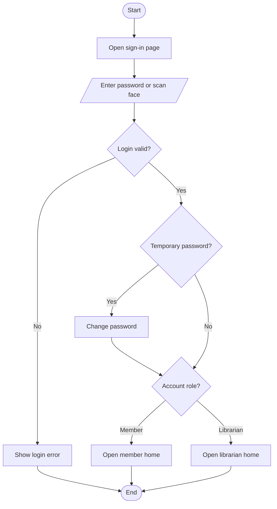

## 2.3.2 Borrower Navigation

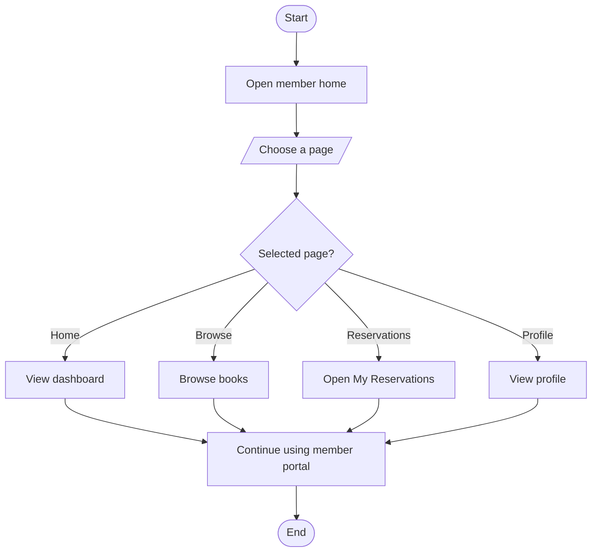

## 2.3.3 Browse Books and Add to Reservation Cart

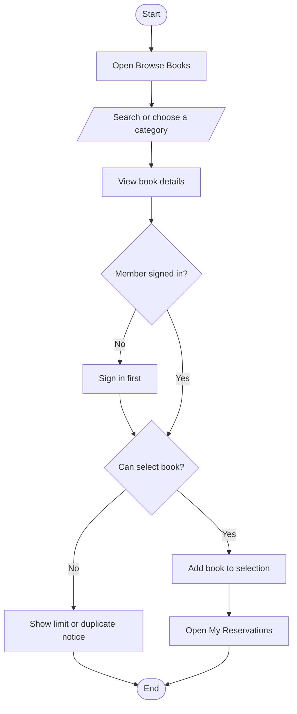

## 2.3.4 Reservation Checkout and Five-Book Limit

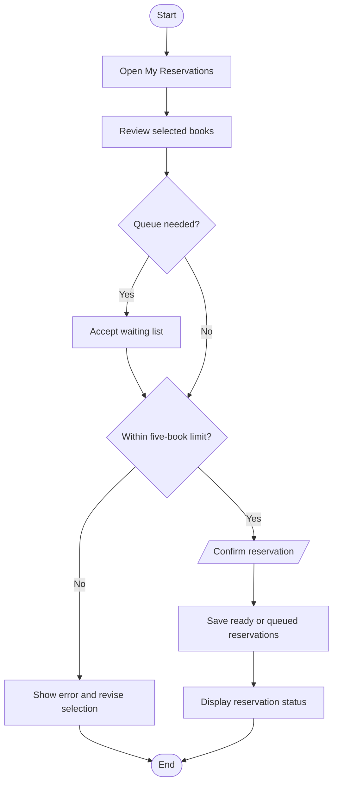

## 2.3.5 Staff Logging and Entrance Attendance

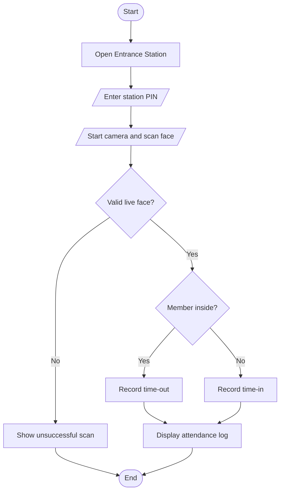

## 2.3.6 Add Book and QR Code Generation

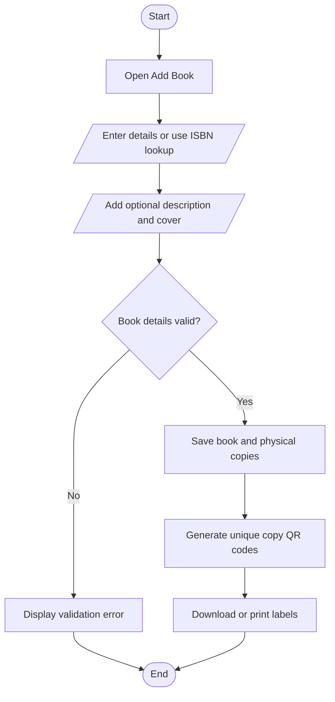

## 2.3.7a Borrow Transaction

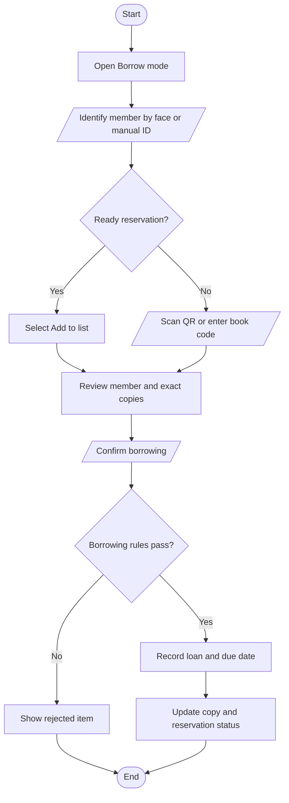

## 2.3.7b Return Transaction

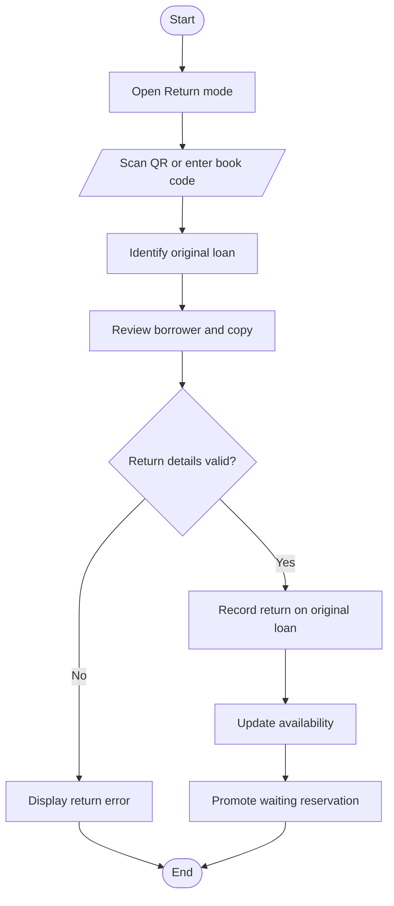

## 2.3.8 Report Generation

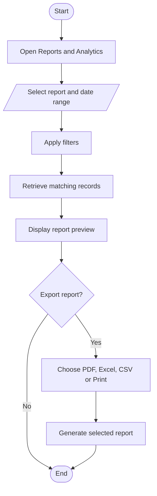

## 2.3.9 Due Books Monitoring

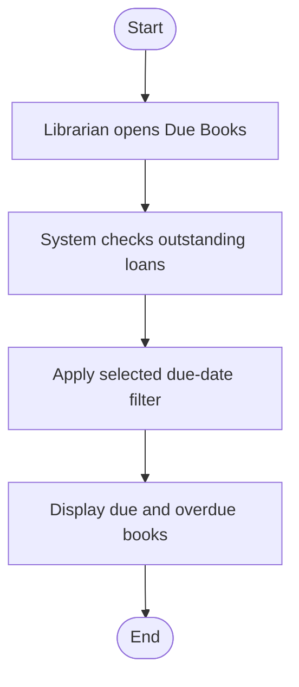

## 2.3.10 Member Registration and Temporary Password Delivery

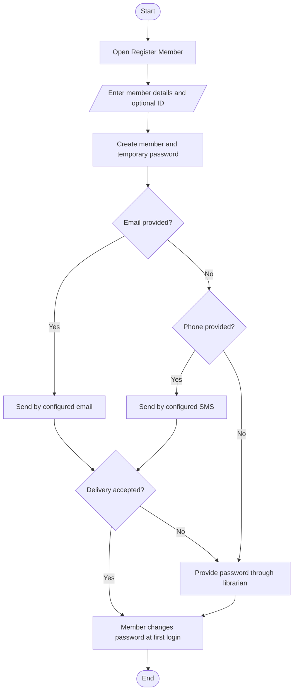

## 2.3.11 Forgotten Password and Librarian-Assisted Recovery

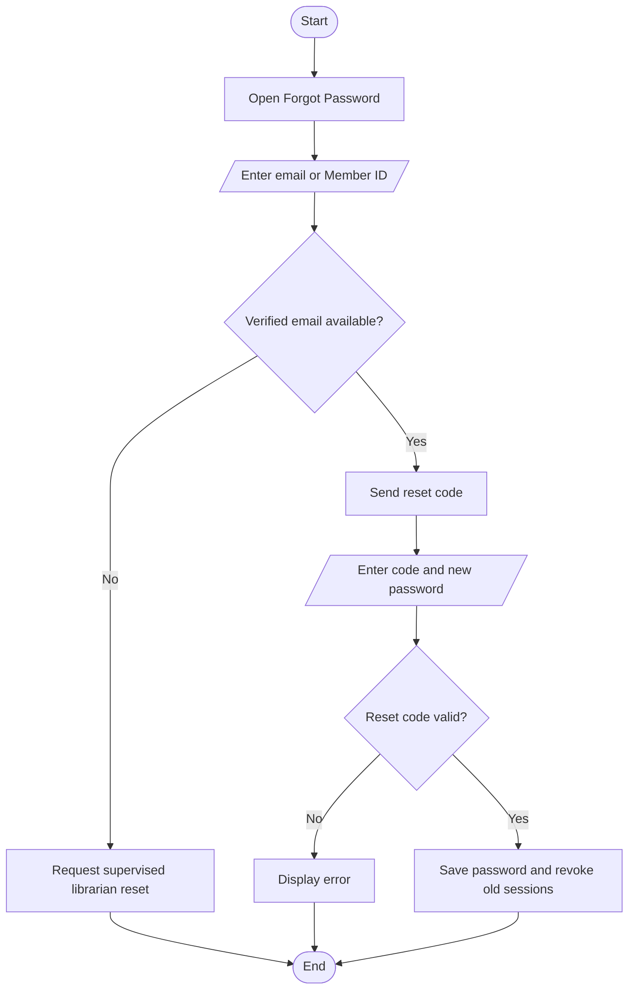

## 2.3.12 First-Login and Voluntary Password Change

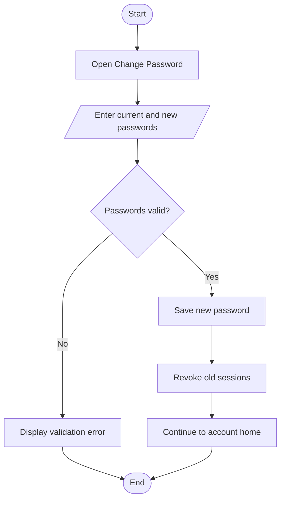

## 2.3.13 Profile Details and Optional Profile Photo

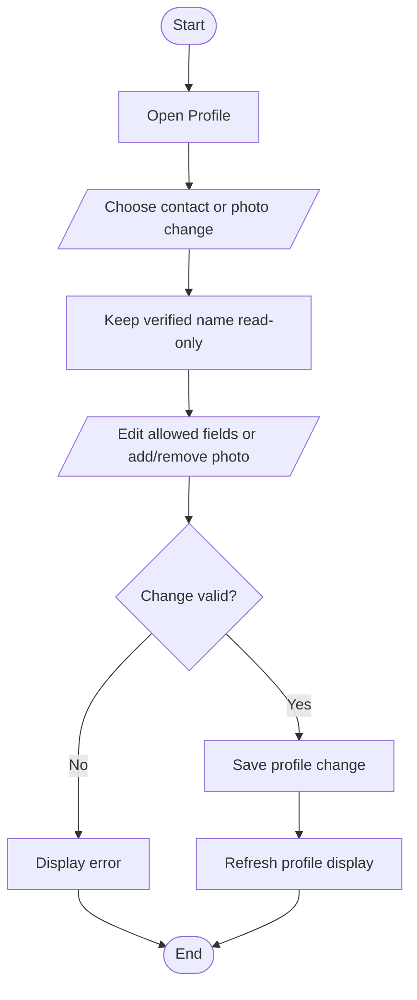

## 2.3.14 Email Change and Contact Verification

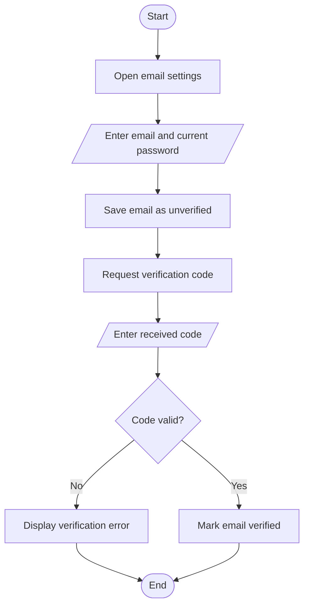

## 2.3.15 Reservation Queue, Pickup, Cancellation and Expiry

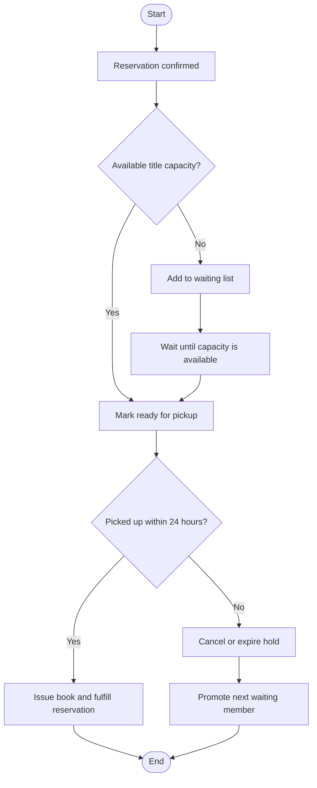

## 2.3.16 Inventory Editing, Stock Adjustment and Title Deletion

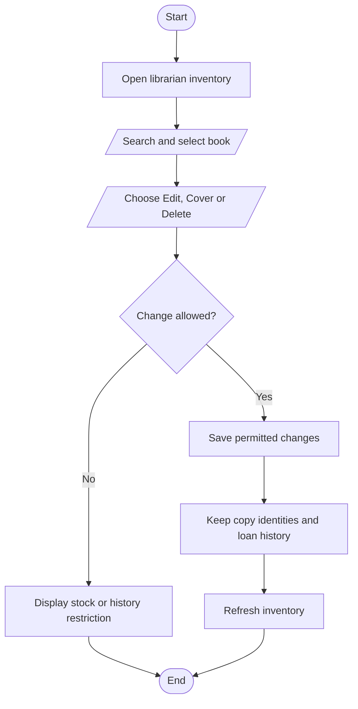

## 2.3.17 ISBN Lookup and Workbook Book Import

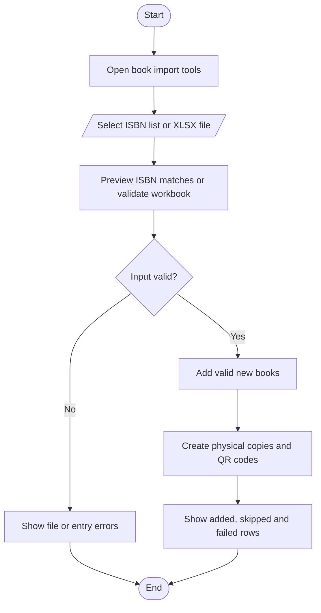

## 2.3.18 Member Status, Password Reset and Account Removal

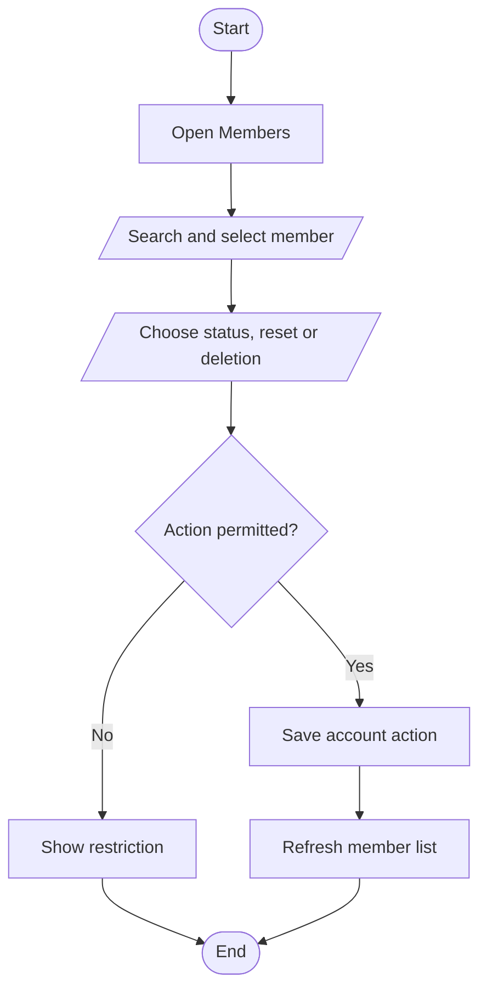

## 2.3.19 Librarian-Assisted Face Enrollment and Face Removal

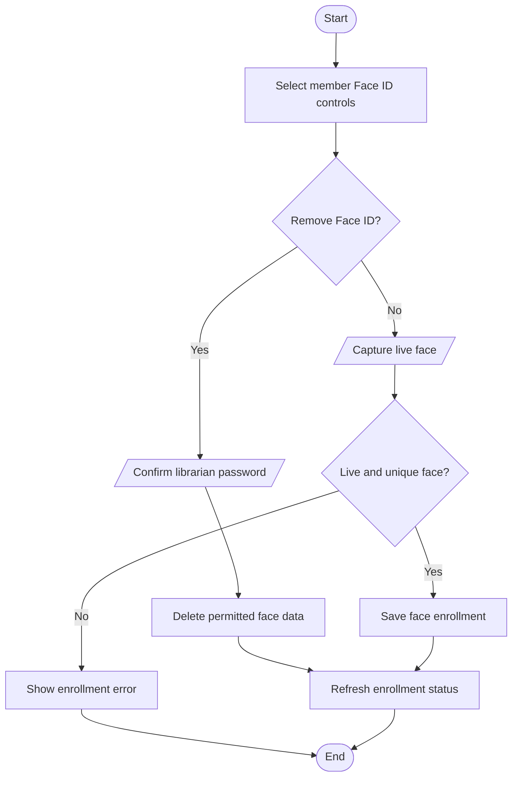

## 2.3.20 Recommendations, Trending and Favorites

```mermaid
flowchart TD
  n_s(["Start"])
  n_a["Open member Browse Books"]
  n_q{"Borrowing history exists?"}
  n_rec["Display recommendations"]
  n_trend["Display Trending"]
  n_other["Display What is new and Books we love"]
  n_select[/"Choose category or sort"/]
  n_heart[/"Add or remove a favorite"/]
  n_show["Refresh books and favorite status"]
  n_e(["End"])
  n_s --> n_a
  n_a --> n_q
  n_q -->|"Yes"| n_rec
  n_rec --> n_trend
  n_q -->|"No"| n_trend
  n_trend --> n_other
  n_other --> n_select
  n_select --> n_heart
  n_heart --> n_show
  n_show --> n_e
```

## 2.3.21 Reading Activity and Goals

```mermaid
flowchart TD
  n_s(["Start"])
  n_a["Open member Dashboard"]
  n_b["Display borrowing, visits and reading goals"]
  n_q{"Update goals?"}
  n_input[/"Enter new targets"/]
  n_save["Save valid goals"]
  n_show["Refresh progress"]
  n_e(["End"])
  n_s --> n_a
  n_a --> n_b
  n_b --> n_q
  n_q -->|"No"| n_e
  n_q -->|"Yes"| n_input
  n_input --> n_save
  n_save --> n_show
  n_show --> n_e
```

## 2.3.22 Loan Issue Reports and In-App Notifications

```mermaid
flowchart TD
  n_s(["Start"])
  n_a["Open own outstanding loan"]
  n_b[/"Select Report Issue"/]
  n_c[/"Choose reason and add note"/]
  n_q{"Loan belongs to member?"}
  n_err["Display error"]
  n_save["Create librarian notification"]
  n_staff["Librarian reviews issue"]
  n_read["Mark notification read"]
  n_e(["End"])
  n_s --> n_a
  n_a --> n_b
  n_b --> n_c
  n_c --> n_q
  n_q -->|"No"| n_err
  n_err --> n_e
  n_q -->|"Yes"| n_save
  n_save --> n_staff
  n_staff --> n_read
  n_read --> n_e
```

## 2.3.23 Physical-Copy QR Label Download and Bulk Export

```mermaid
flowchart TD
  n_s(["Start"])
  n_a["Open Print QR"]
  n_b[/"Search physical copies"/]
  n_c[/"Select one, selected or all matching copies"/]
  n_q{"Label selection valid?"}
  n_err["Display error"]
  n_file["Generate PNG, PDF or ZIP"]
  n_print["Print exact-copy labels"]
  n_e(["End"])
  n_s --> n_a
  n_a --> n_b
  n_b --> n_c
  n_c --> n_q
  n_q -->|"No"| n_err
  n_err --> n_e
  n_q -->|"Yes"| n_file
  n_file --> n_print
  n_print --> n_e
```

## 2.3.24 Appearance Settings and Entrance Station PIN Replacement

```mermaid
flowchart TD
  n_s(["Start"])
  n_a["Open Settings"]
  n_q{"Change station PIN?"}
  n_theme["Select Light or Dark mode"]
  n_input[/"Enter password and new PIN"/]
  n_t{"Password and PIN valid?"}
  n_err["Display error"]
  n_save["Save protected PIN"]
  n_unlock["Unlock station with new PIN"]
  n_e(["End"])
  n_s --> n_a
  n_a --> n_q
  n_q -->|"No"| n_theme
  n_theme --> n_e
  n_q -->|"Yes"| n_input
  n_input --> n_t
  n_t -->|"No"| n_err
  n_err --> n_e
  n_t -->|"Yes"| n_save
  n_save --> n_unlock
  n_unlock --> n_e
```

## 2.3.25 Acquisition Metadata Entry and Import

```mermaid
flowchart TD
  n_s(["Start"])
  n_a["Open Reports: Acquisitions"]
  n_b[/"Enter copy ID or upload metadata"/]
  n_c["Review existing copy and details"]
  n_q{"Records valid and current?"}
  n_err["Show error and reload"]
  n_save["Confirm and save metadata"]
  n_show["Refresh acquisition report"]
  n_e(["End"])
  n_s --> n_a
  n_a --> n_b
  n_b --> n_c
  n_c --> n_q
  n_q -->|"No"| n_err
  n_err --> n_e
  n_q -->|"Yes"| n_save
  n_save --> n_show
  n_show --> n_e
```

## 2.3.26 Librarian Workspace, Dashboard and Navigation

```mermaid
flowchart TD
  n_s(["Start"])
  n_a["Open librarian dashboard"]
  n_b["View summaries and notices"]
  n_c[/"Open sidebar menu"/]
  n_d[/"Choose work area"/]
  n_open["Open selected librarian page"]
  n_e(["End"])
  n_s --> n_a
  n_a --> n_b
  n_b --> n_c
  n_c --> n_d
  n_d --> n_open
  n_open --> n_e
```

## 2.3.27 Safe Submission, Partial Results and Unknown Outcome Recovery

```mermaid
flowchart TD
  n_s(["Start"])
  n_a["Review and submit operation"]
  n_q{"Result confirmed?"}
  n_keep["Keep original request and stop next items"]
  n_recover["Check or retry original request"]
  n_result["Display confirmed result"]
  n_next["Keep successful items and identify remaining items"]
  n_known{"Outcome now known?"}
  n_unknown["Keep request pending and seek assistance"]
  n_e(["End"])
  n_s --> n_a
  n_a --> n_q
  n_q -->|"No"| n_keep
  n_keep --> n_recover
  n_q -->|"Yes"| n_result
  n_result --> n_next
  n_next --> n_e
  n_recover --> n_known
  n_known -->|"Yes"| n_result
  n_known -->|"No"| n_unknown
  n_unknown --> n_e
```

## 2.3.28 Category Normalization and Librarian Review

```mermaid
flowchart TD
  n_s(["Start"])
  n_a["System reads book category"]
  n_q{"Category recognized?"}
  n_save["Save visible category"]
  n_hide["Keep unresolved book hidden"]
  n_review["Open Add Book category review"]
  n_choose[/"Choose supported category"/]
  n_apply["Save review resolution"]
  n_show["Refresh catalog category"]
  n_e(["End"])
  n_s --> n_a
  n_a --> n_q
  n_q -->|"Yes"| n_save
  n_save --> n_show
  n_q -->|"No"| n_hide
  n_hide --> n_review
  n_review --> n_choose
  n_choose --> n_apply
  n_apply --> n_show
  n_show --> n_e
```
